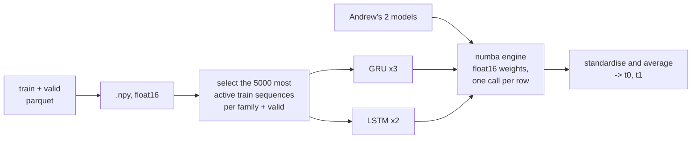

# Alpha Connectome — recurrent ensembles for order-book forecasting

Team solution for the **Wunder Fund Alpha Connectome** challenge (November 2026, ~5 800 teams).
The task: from a stream of anonymised order-book features of two instruments, predict two indicators of
the future price move of one of them, one row at a time, under a 60-minute single-core CPU limit.

**Result:** public score **0.6571** (organisers' baseline 0.5935), place 471 of 5 838 on the public leaderboard, with an ensemble of 3 GRU and
2 LSTM networks running in a custom numba inference engine.

## The problem in brief

- 12 480 sequences × 20 000 steps × 112 features (quantile-normalised prices, volumes and trades of two
  instruments, plus 8 hidden columns). Steps 0–98 are warm-up.
- Targets `t0`, `t1` ∈ [−2, 2]. Metric: **|y|-weighted Pearson correlation over all scored rows of all
  sequences at once**, averaged over the two targets.
- Inference is a Python callback per row: ~39 M calls, 1 CPU core, 60 minutes, deterministic.

## What mattered (and what we learned)


| Step | Public score | Why it works |
|---|---|---|
| Organisers' baseline GRU | 0.5935 | — |
| First own GRU | 0.6399 | — |
| Train on `valid` as well | 0.6490 | `valid` is a different slice of data and the test resembles it (train only: 0.6434) |
| First ensemble with Andrew's models | 0.6555 | Averaging models with different errors |
| + GRU trained on the most *active* sequences | 0.6563 | Activity (share of price-change steps) is higher in `valid`/test; quiet sequences carry little signal |
| 3 active GRUs + Andrew's 2 models | 0.6567 | More diverse members |
| + 2 LSTMs (float16 weights in the engine) | **0.6571** | LSTMs are stronger on scored rows, GRUs on all rows; the mix is best |




Findings about the data that shaped these decisions:

- **Discrete target.** Values are `k·u` with a per-sequence unit `u ∈ {0.1254, 0.2413, 0.4685, 0.6569}`
  (four "families"), clipped to ±2. The family is identifiable from the first 99 steps (99.9 %).
- **Event clock.** The target changes *only* on steps where the price columns of instrument 0 change
  (all 22 at once). In event time the target behaves like a sum of the next 2–3 price moves.
- **Train/valid shift.** A classifier separates `train` and `valid` sequences with AUC 0.995 (mostly by
  volume levels); `valid` is markedly more active (0.37 vs 0.28 price events per step).
- **Honest validation.** A 300-sequence hold-out is noisy (±0.003). Under a distribution shift the right
  local test is *train → valid*, not a random hold-out from the training slice.

Details, including the long list of ideas that did **not** work, are in [REPORT.md](REPORT.md); all figures are built by
[`docs/figures.py`](docs/figures.py) from the small tables in `docs/results/` and walked through in
[`notebooks/09_results_and_figures.ipynb`](notebooks/09_results_and_figures.ipynb).

## Repository layout

```
src/wnn/
  metric.py       competition metric, streaming accumulator, family detection, family-mix re-weighting
  features.py     causal event features, sequence activity
  data.py         splits, active-sequence selection, family weights, parquet → .npy
  models.py       GRU / LSTM networks, ONNX step wrapper
  train.py        training loop (weighted loss, truncated BPTT, OneCycle) + CLI
  export_onnx.py  one-row ONNX export with a numerical check
notebooks/        exploratory analysis and experiments (as run in Colab)
tests/            unit tests for the metric, features and data selection
```

## Reproduce

```bash
pip install -e ".[train,dev]"
pytest -q

# data: download the starter pack from the competition page, then convert, e.g.
python -c "from wnn.data import parquet_to_npy; import numpy as np; \
           parquet_to_npy('train.parquet', 'data/train', np.arange(10607))"

# one LSTM of the final ensemble (≈35 min on a T4)
python -m wnn.train --data data --cell lstm --active 5000 --seed 0 --out lstm_s0.pt
```

The final submission ran all models inside a numba engine (one compiled call per row, float16 weight
matrices, ~33 µs per model per row). The engine was written by a teammate; the LSTM support and the
ensembling tooling are described in the report.

## Team

Four people — see [AUTHORS.md](AUTHORS.md).
