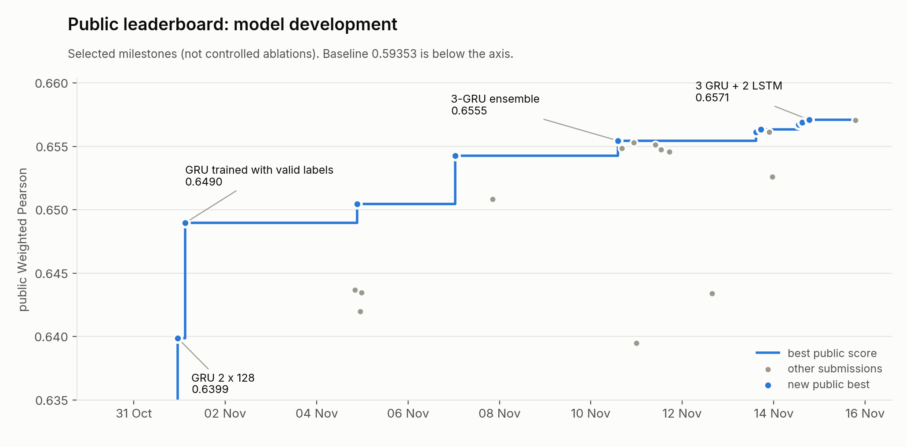
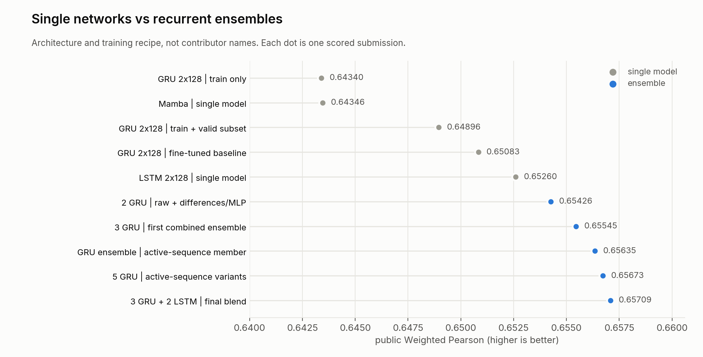
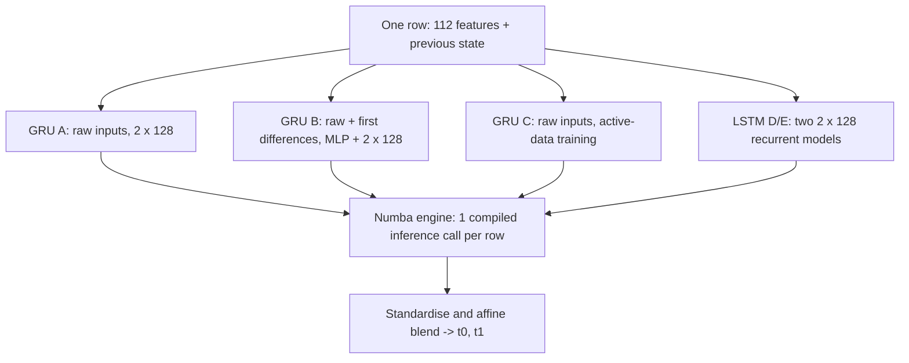
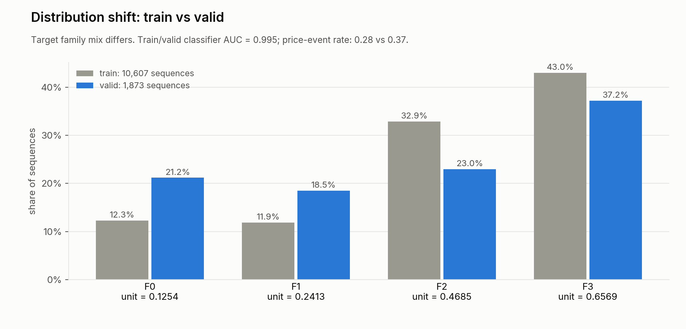
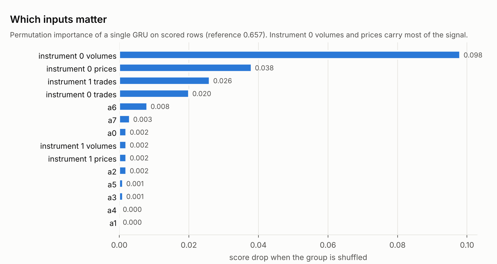
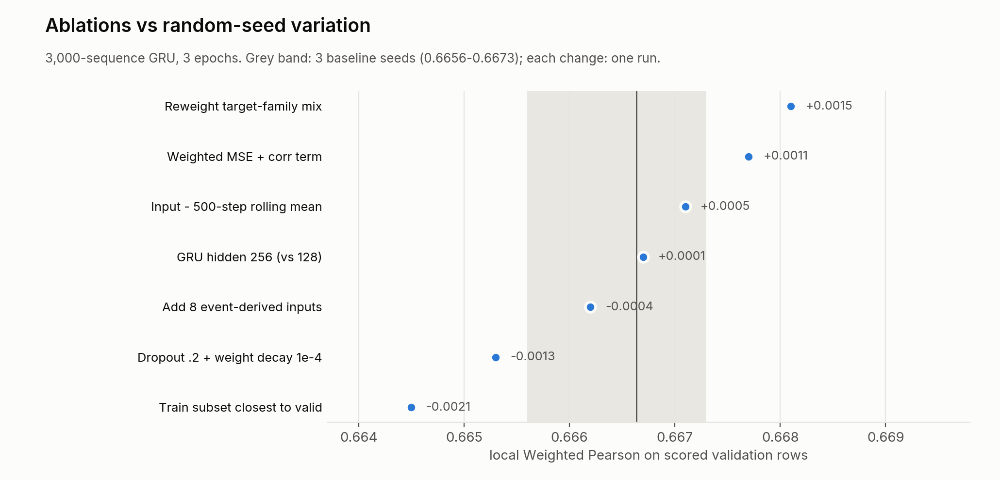
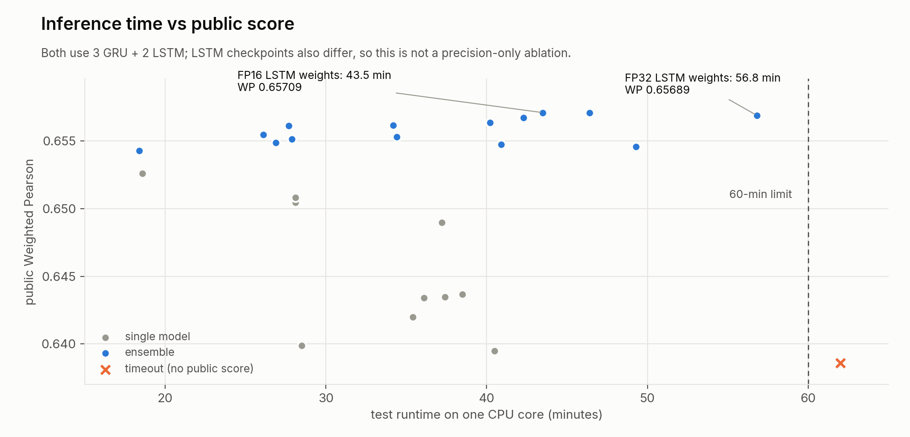

# Alpha Connectome — recurrent ensembles for order-book forecasting 

Team solution for the **Wunder Fund Alpha Connectome** competition (November 2026).
From a causal stream of **112 anonymised features** describing two instruments, predict two indicators of the future price movement of instrument `i0`.

**Best public score: 0.65709** (organisers' baseline: 0.59353); **public leaderboard snapshot: 471 / 5,838 teams**. The best submission combined **3 GRUs + 2 LSTMs** in a custom **Numba CPU inference engine**.
These are *public* leaderboard results, not a verified final private ranking.     

## Task and constraints


| Item            | Specification                                                                                                                |
| --------------- | ---------------------------------------------------------------------------------------------------------------------------- |
| Data            | `train`: 10,607 sequences; `valid`: 1,873 sequences; 20,000 time steps each                                                  |
| Input           | 112 features per step: price-like, volume-like and trade-related features for`i0`/`i1`, plus `a0`–`a7`                      |
| Targets         | `t0`, `t1` — undisclosed indicators of the future movement of **`i0`**                                                      |
| Metric          | Mean of two**global, \|target\|-weighted Pearson correlations** on scored rows; targets and predictions clipped to `[-2, 2]` |
| Causality       | Current and previous rows only; 99 warm-up steps; state reset between independent sequences                                  |
| Test-time limit | About 39.4 million rows; 1 CPU core; no GPU; 60 minutes; deterministic predictions                                           |

## Results: what changed



The following are **observed public submissions**, not a perfectly controlled ablation study. Changing a model, dataset, or blend can affect the score simultaneously.


| Submitted approach                       |   Public WP | Concrete change                                                                                                           |
| ---------------------------------------- | ----------: | ------------------------------------------------------------------------------------------------------------------------- |
| Organisers' baseline GRU                 |     0.59353 | Reference submission; output clipping also matters for its raw scale                                                      |
| GRU, 2 layers × 128 units               |     0.63988 | Independently trained causal recurrent regressor                                                                          |
| GRU, 2 × 128; 6,573 training sequences  |     0.64896 | 5,000 train + 1,573 labeled valid sequences; the train-only comparison scored 0.64340                                     |
| Two-GRU ensemble                         |     0.65426 | Standard two-layer GRU + GRU with**112 current + 112 first-difference features**, an input projection and MLP output head |
| Three-GRU ensemble                       |     0.65545 | The two distinct GRUs above combined with another two-layer GRU                                                           |
| Ensemble including activity-selected GRU |     0.65635 | Added a GRU trained on high price-event-activity sequences                                                                |
| Five-GRU blend                           |     0.65673 | A later ensemble incorporating additional GRU variants                                                                    |
| **Three GRUs + two LSTMs**               | **0.65709** | Final blend: 3 GRUs (standard, difference/MLP, active-data) + 2 two-layer LSTMs                                           |



**Interpretation:** the strongest recorded standalone model was a two-layer **LSTM (0.65260)**. The five-model blend reached **0.65709**. This is consistent with the value of combining models that make partly different errors; it is not proof that every added model improved the score individually.

## Final ensemble: actual architecture

The five-member structure was verified from the final submission's packed model metadata and weights (`mods`, `meta`, `weights.npz`), not inferred from contributor names.


| Member           | Input and layers                                                                                                           | Why it differs                                                                   |
| ---------------- | -------------------------------------------------------------------------------------------------------------------------- | -------------------------------------------------------------------------------- |
| **GRU A**        | 112 raw inputs → GRU(128) → GRU(128) → Linear(2)                                                                        | Fine-tuned baseline-shaped model                                                 |
| **GRU B**        | `[x_t, x_t − x_(t−1)]` (224 features) → normalisation/clip → Linear(96) + SiLU → 2 × GRU(128) → MLP(224 → 64 → 2) | Explicit first differences; output head also sees the current projected features |
| **GRU C**        | 112 raw inputs → 2 × GRU(128) → Linear(2)                                                                               | Trained with high-activity-sequence selection                                    |
| **LSTM D and E** | Each: 112 raw inputs → 2 × LSTM(128) → Linear(2)                                                                        | Different learned weights, distinct recurrent cell type from the GRUs            |

All five networks process each input row in sequence, keep their own recurrent states, and return two values. The ensemble combines their outputs with **per-target centring and standardisation**; its exported form is a fixed affine blend:

$$
\widehat y_j = c_j + \sum_{k=1}^{5} a_{kj}\,p_{kj}, \qquad j\in\{0,1\}.
$$

The coefficients and offsets are packed into `coef` and `const` in the submission. They are **not** arbitrary contributor-specific weights.



## Data analysis and validation



- **Target families:** within each sequence, targets take values on a discrete scale `k × u`, where `u ∈ {0.1254, 0.2413, 0.4685, 0.6569}`. This suggested an event-based structure, but the targets' exact economic meaning is undisclosed.
- **Event time:** target values changed at steps associated with simultaneous changes in the 22 `i0` price-like columns. Modelling the next few price-change events was explored but did not beat the recurrent ensemble.
- **Distribution shift:** a train-vs-valid classifier reached **ROC-AUC 0.995**; the observed price-event rate was approximately **0.28 (train) vs 0.37 (valid)**. Random hold-outs within a single split could therefore give an over-optimistic comparison.
- **Active sequences:** the useful late-stage training recipe selected about **5,000 high-activity train sequences**, accounting for the target-family mix, and combined them with labeled valid data. It was included in higher-scoring public ensembles, but the available experiment logs do **not** isolate its effect from other model and blend changes. Earlier local scores quoted for activity-only selection were omitted from the revised report because their original calculation logs were not preserved.



Permutation importance for one GRU indicated that **`i0` volume-like and price-like groups** held most of the predictive signal. Because the feature columns are anonymised, index order must not be treated as known order-book depth.



A 3,000-sequence, three-epoch GRU experiment showed that several feature and architecture tweaks produced changes close to the **0.0017 range across three baseline seeds**. This is why improvements need validation across seeds and distribution splits, not just one run.

## Engineering: inference on one CPU core



- **Training:** models were trained offline in PyTorch; the platform did not allow GPU inference.
- **Inference:** a custom Numba JIT engine runs all five recurrent models in **one compiled call per input row**, rather than repeatedly invoking separate PyTorch or ONNX graphs.
- **Optimisation:** matrix–vector products operate on transposed weight matrices; recurrent gates use compiled numerical approximations; weight matrices are stored as `float16`, while most arithmetic is carried out in `float32`.
- **Runtime:** the best submission (`final5_mx16_submission.zip`) ran in **43 min 32 s**. Another five-model submission with two LSTMs took **56 min 46 s**. **These versions used different LSTM checkpoints as well as different weight formats**, so their runtime difference must not be attributed solely to `float16` without a controlled benchmark.
- **Correctness:** the exported runtime performs a numerical self-test against stored reference predictions and resets recurrent state between sequences.
- **Code:** the engine, the ensemble builder, the pre-submit checker and the speed benchmark are in [`engine/`](engine/README.md), together with the training pipeline of GRU A and GRU B.

## Project structure

```text
src/wnn/
  metric.py       Weighted Pearson metric and streaming evaluation
  features.py     Causal event features and sequence activity
  data.py         Sequence splits, active selection, parquet -> .npy
  models.py       GRU/LSTM PyTorch definitions and ONNX step wrapper
  train.py        Weighted loss, truncated BPTT and training CLI
  export_onnx.py  Export and numerical validation
engine/           Numba inference engine, ensemble builder, pre-submit checker, speed benchmark,
                  training pipeline of GRU A/B (see engine/README.md)
notebooks/        Colab experiment history, one folder per contributor (see notebooks/README.md)
docs/results/     Small source tables used by the figures
docs/figures.py  Regenerate all six figures
docs/img/         Rendered PNG charts
REPORT.md         Technical findings, including failed experiments
```

## Reproduce the included research code

```bash
pip install -e ".[train,dev,figures]"
pytest -q
python docs/figures.py

# Download the competition training files separately, then convert them:
python -c "from wnn.data import parquet_to_npy; import numpy as np; \
           parquet_to_npy('train.parquet', 'data/train', np.arange(10607))"

# Example training command for an active-sequence LSTM:
python -m wnn.train --data data --cell lstm --active 5000 --seed 0 --out lstm_s0.pt

# Build and check an ensemble submission with the Numba engine (see engine/README.md):
pip install -e ".[train,engine]"
python engine/prepare_data.py --src valid_sub.parquet --out data/engine_valid
python engine/build_ensemble.py --valid-dir data/engine_valid --out submissions/ens \
    --model "a=runs/ft/epoch_0.pt@0.5" --model "b=runs/gru/best.pt@0.5"
python engine/check_submission.py submissions/ens.zip --data valid_sub.parquet
```

The public repository contains the training/analysis code, the Numba inference engine with its submission tooling (`engine/`) and recorded experimental results. **Rebuilding the exact final submission additionally requires the trained checkpoints and packed weights** (and the LSTM model types added to the engine for the final submission), which are not part of the repository.

For the complete research log, see [REPORT.md](REPORT.md) and [the notebook index](notebooks/README.md).

## Team

Four contributors; see [AUTHORS.md](AUTHORS.md).

## Additional contributor notebooks: Max

[Max's saved Colab notebooks and supporting source](notebooks/Max/README.md)
include exploratory data analysis and the LSTM 2×128 training/resume pipeline,
Numba LSTM integration, export diagnostics and honest valid300 ensemble comparisons.
The recorded local scores are **0.661758** for LSTM and **0.663036** for
honest3 + LSTM (**+0.002043** over honest3); these are offline family-mix validation
scores, separate from the public leaderboard results above. The saved experiment
history includes an unsuccessful float16 parity check and a trial ensemble that
failed the runtime gate; it does not certify the exact final team submission.
