# Alpha Connectome — Technical Report

**A research log of recurrent forecasting, distribution shift and CPU-constrained inference**  
Wunder Fund Alpha Connectome · November 2026

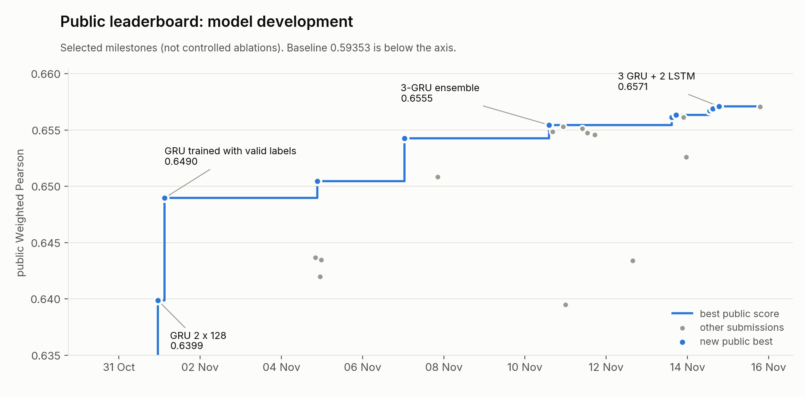

> **Best observed public score: 0.65709 Weighted Pearson**, versus an organisers' baseline of **0.59353** (+0.06356 absolute). A public leaderboard snapshot placed the team **471 / 5,838**. The best submission used **three GRUs and two LSTMs**, evaluated in **43 min 32 s** on one CPU core. These numbers are *public* results, not a verified private-final ranking.

The report is organised around a question: **which modelling hypotheses actually improved generalisation, and which looked promising only locally?** It separates observations, hypotheses, local experiments and public leaderboard measurements. Descriptions of models use **architecture and training recipe**, never contributor names. Human contributions are documented separately in [AUTHORS.md](AUTHORS.md).

## Contents

1. [Problem and evaluation](#1-problem-and-evaluation)
2. [Data and hidden-target structure](#2-data-and-hidden-target-structure)
3. [Loss and calibration](#3-loss-and-calibration)
4. [Validation under distribution shift](#4-validation-under-distribution-shift)
5. [Which experiments worked?](#5-which-experiments-worked)
6. [Final ensemble: five specific models](#6-final-ensemble-five-specific-models)
7. [Inference under a 60-minute CPU limit](#7-inference-under-a-60-minute-cpu-limit)
8. [What did not work](#8-what-did-not-work)
9. [Limitations, lessons and reproducibility](#9-limitations-lessons-and-reproducibility)

---

## 1. Problem and evaluation

Each sample is one moment of a market-data stream for two anonymised instruments. The task is to predict `t0` and `t1`, **two undisclosed indicators of future price movement for instrument `i0`**. The precise target definitions are not public; the second instrument, `i1`, supplies features but has no targets.

| | Competition specification |
|---|---|
| **Training set** | 10,607 independent sequences × 20,000 rows = 212.14 million rows |
| **Validation set** | 1,873 sequences × 20,000 rows = 37.46 million rows |
| **Test set** | 1,970 sequences × 20,000 rows = 39.40 million rows |
| **Input per row** | 112 `float32` features: price-like, volume-like and trade features for both instruments, plus `a0`–`a7` |
| **Output per row** | Two values: `[t0, t1]` |
| **Temporal rules** | Use only the current or earlier steps of the *same* sequence; reset state at each new `seq_ix` |
| **Warm-up** | Steps 0–98 update model state but do not require predictions |
| **Test platform** | One CPU core, 16 GB RAM, no GPU; all test sequences within 60 minutes |

**Input layout.** For each instrument there are 22 price-like columns (`p`), 22 volume-like (`v`), four trade-price (`dp`) and four trade-volume (`dv`) columns. The eight remaining features are `a0`–`a7`. The price/volume indexes are **fixed identifiers**, *not* guaranteed rank in the order book; the feature names cannot safely be reinterpreted as best-bid or deeper-level order.


### The scoring objective

For each target independently, only rows satisfying `need_prediction AND is_scored` are included. Let `y_i` and `p_i` be the target and prediction **after clipping both to `[-2, 2]`**, and define `w_i = |y_i|`. The metric is the weighted Pearson correlation

$$
\rho_w(y,p)=\frac{\sum_i w_i (y_i-\bar y_w)(p_i-\bar p_w)}{
\sqrt{\sum_i w_i(y_i-\bar y_w)^2}\sqrt{\sum_i w_i(p_i-\bar p_w)^2}},
\qquad \bar y_w=\frac{\sum_i w_i y_i}{\sum_i w_i}.
$$

The final score averages `ρ_w(t0)` and `ρ_w(t1)` **globally across all scored rows**, not one score per sequence. The validation mask is visible, but the test mask is hidden. A robust solution must predict **every required row** rather than relying on the observed validation mask.

## 2. Data and hidden-target structure

### Finding A — Targets have four discrete value scales

Although the targets are floating-point columns, analysis found values on sequence-specific grids `k × u`, with one of four scales:

| Family | Approximate unit `u` | Train sequence share | Valid sequence share |
|:---:|---:|---:|---:|
| F0 | 0.1254 | 12.3% | 21.2% |
| F1 | 0.2413 | 11.9% | 18.5% |
| F2 | 0.4685 | 32.9% | 23.0% |
| F3 | 0.6569 | 43.0% | 37.2% |

Shares are rounded from [`family_shift.csv`](docs/results/family_shift.csv). The overall family composition differs between train and validation.

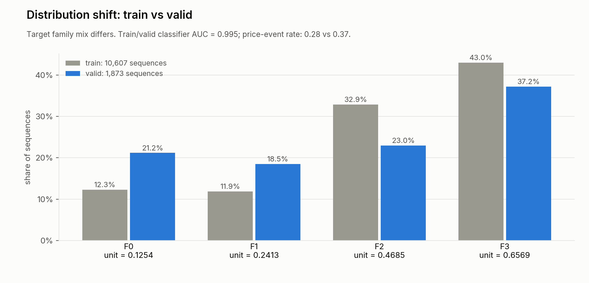

A family classifier derived from information in the first 99 steps reached approximately **99.9% accuracy** in the exploratory analysis. This motivated family-aware diagnostics, but an explicit oracle family one-hot feature did **not** improve the model: the recurrent network already appeared to capture the relevant structure.

### Finding B — Target changes follow an event clock

In the analysed sequences, target values changed only when the `i0` price-like columns changed (the 22 columns changed together). This suggested analysing **price-change events**, rather than treating every row as equally informative in time.

The sum `S = t0 + t1` was often `−u` or `−2u` in larger-unit families, and `D = t0 − t1` had an event-time increment pattern consistent with a short window of future moves. A price-based reconstruction of target increments reached approximately **0.94 correlation** in the exploratory work.

**Interpretation, not ground truth:** one plausible explanation is a pair of long/short outcomes with a transaction-cost-like offset, but the organisers did not disclose the economic definitions. We did **not** assume this interpretation in the final predictor.

### Finding C — The difficult family matters disproportionately

Local diagnostics showed family F3 at roughly **0.40 WP** versus approximately **0.72–0.78** in F0–F2, while F3 accounted for a large portion of the metric's weighted variation. This made F3 the focus of event predictors and past-target reconstruction experiments. Neither ultimately improved the final ensemble reliably.

### Which feature groups mattered?

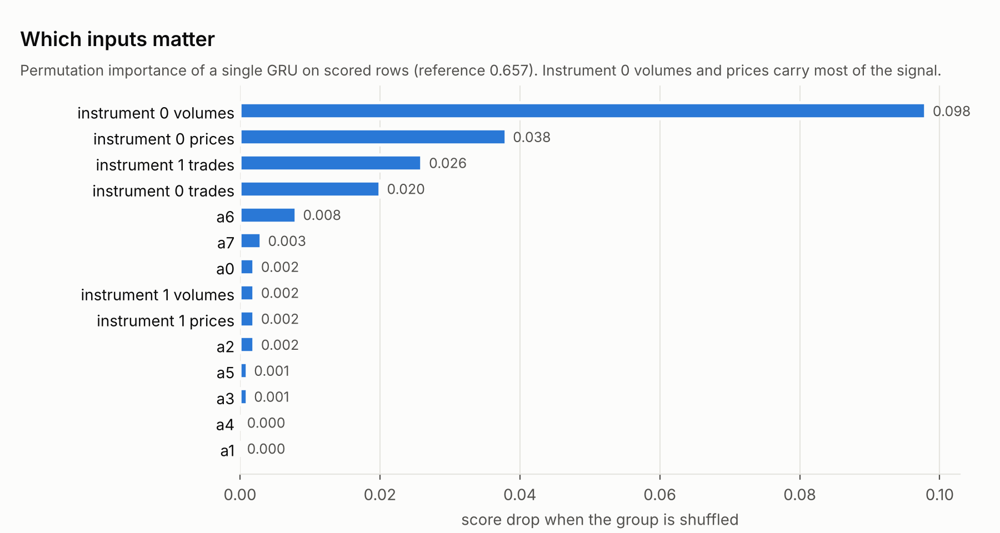

For one GRU reference model, shuffling `i0` volume-like columns reduced scored-row WP by **0.098**, and shuffling `i0` price-like columns by **0.038**. `i1` price- and volume-like groups had much smaller drops in that specific check. These are **permutation-importance measurements for one trained model**, not universal causal claims about financial markets. Also, column-index order should not be interpreted as known order-book depth.

## 3. Loss and calibration

A naive regression objective does not account for the competition's target weighting. The main training surrogate was

$$
\mathcal L_{\mathrm{weighted\,MSE}}=\frac{1}{N}\sum_i |y_i|(p_i-y_i)^2.
$$

Its population minimiser at a fixed input is the target's weighted conditional mean:

$$
p^*(x)=\frac{\mathbb E[|Y|Y\mid X=x]}{\mathbb E[|Y|\mid X=x]}.
$$

This makes weighted MSE a useful **metric-aligned surrogate**, rather than a numerical implementation of Weighted Pearson itself. Clipping, finite capacity and optimisation mean that lower weighted MSE does not guarantee a higher leaderboard correlation in every experiment.

**Calibration was independently important.** Because predictions are clipped during scoring, excessively large raw outputs can saturate at `−2` and `2` and lose correlation. In the recorded submissions, multiplying the organisers' baseline output by **0.3** improved public WP from **0.59353 to 0.65045**. That result should **not** be credited to a change in loss: it demonstrates how crucial the clipping rule and output scale were.

Training code: [`src/wnn/train.py`](src/wnn/train.py). Metric implementation: [`src/wnn/metric.py`](src/wnn/metric.py).

## 4. Validation under distribution shift

### The central obstacle: train and valid were distinguishable

An adversarial-validation classifier distinguishing training from validation sequences reached **ROC-AUC ≈ 0.995**, with volume levels among the strongest separating signals. Price-change activity was also higher in validation:

| Split | Approximate share of steps with `i0` price-change events |
|---|---:|
| `train` | **0.28** |
| `valid` | **0.37** |

This is evidence of a strong distribution shift between the supplied splits. It does **not**, by itself, prove that test has exactly the validation distribution.

A small 300-sequence hold-out was noisy in recorded comparisons. The separate 3,000-sequence training ablations below show a **0.0017 WP** range across the three baseline seeds on the scored validation mask. A model trained exclusively on `train` scored **0.64340 public**, while a related GRU using 5,000 train sequences plus 1,573 labelled validation sequences scored **0.64896 public**. Those submissions help motivate the shift analysis, but also changed training composition and are not an isolated causal test.

### The validation strategy we converged on

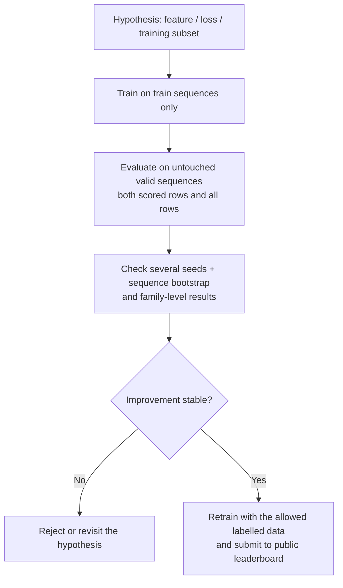

The final training recipes could use labelled `valid` rows **because the competition allowed it**. But once labels are reused for training, scores on those same rows are no longer independent validation. We therefore distinguish the **train → valid diagnostic experiments** from **public leaderboard scores** throughout this report.

## 5. Which experiments worked?

### What the local experiments actually verify

The local 3,000-sequence GRU experiments in [`notebooks/07_shift_and_active_selection.ipynb`](notebooks/07_shift_and_active_selection.ipynb) (the cell that builds `RES2`) retain the printed metrics for three baseline seeds and six alternative training/feature configurations. The exact numbers are also transcribed in [`docs/results/experiments_3k.csv`](docs/results/experiments_3k.csv).

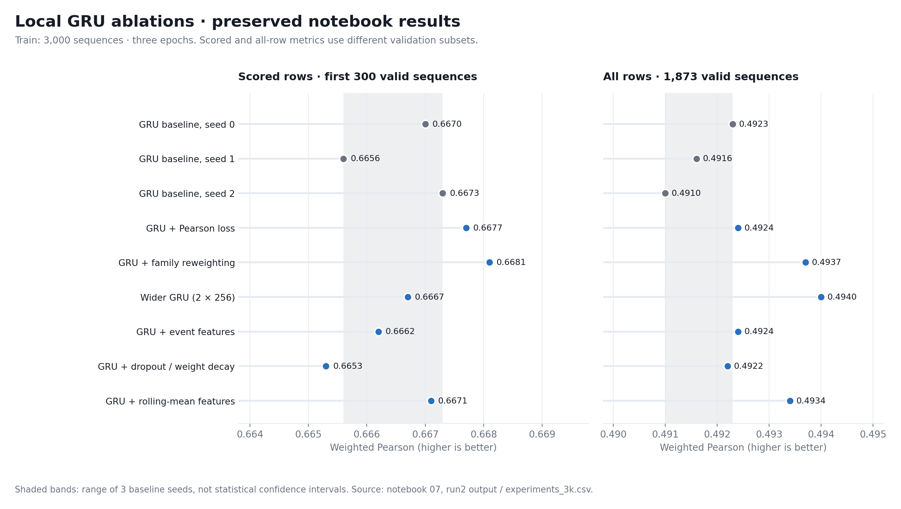

| Local GRU experiment | Scored-row WP (300 valid sequences) | All-row WP (1,873 valid sequences) | Interpretation |
|---|---:|---:|---|
| Baseline, mean across three seeds | **0.6666** | 0.4916 | Scored WP range **0.6656–0.6673** |
| Weighted MSE + Pearson loss term | 0.6677 | 0.4924 | Small result within the baseline seed spread |
| Reweight target families to validation mix | 0.6681 | 0.4937 | Higher in this run, not tested across multiple seeds here |
| Wider two-layer GRU (256 hidden units) | 0.6667 | 0.4940 | Increased computation without a clear scored-row gain |
| Event-derived input features | 0.6662 | 0.4924 | No improvement on scored rows |
| Dropout 0.2 + weight decay 1e−4 | 0.6653 | 0.4922 | Lower scored-row WP |
| Inputs plus rolling-mean deviation features | 0.6671 | 0.4934 | Result within the baseline scored-row spread |

**Metric populations differ:** `is_scored` WP was computed on the scoring mask for the first 300 validation sequences, whereas `all-row` WP pooled non-warm-up steps from all 1,873 validation sequences. Neither is a public-leaderboard result. The three baseline points and all alternative experiments above are traceable to preserved notebook output; the displayed baseline mean is calculated from the three seeds.

### Evidence for the high-activity training recipe

A price-change event was defined using changes in the 22 price-like `i0` features, and the final training code implements selection of high-activity sequences. The observed `train`/`valid` shift (about 0.28 versus 0.37 event steps) motivated this hypothesis.

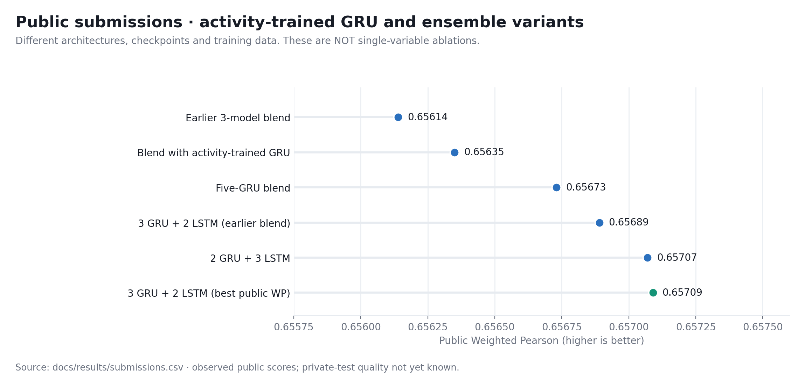

The figure above contains **actual public submission scores** from [`docs/results/submissions.csv`](docs/results/submissions.csv). The blend that added an activity-trained GRU scored **0.65635**; subsequent all-GRU and mixed GRU/LSTM submissions reached **0.65673**, **0.65689**, **0.65709** and **0.65707**. These are *different checkpoints and blends*, not a controlled test that changes only sequence selection. They support the use of that recipe in the final pipeline, but cannot establish an isolated causal benefit from activity selection.

**Evidence gap explicitly removed:** the original narrative reported additional local numbers for selecting the top 3,000 active sequences, an activity-matched subset, one LSTM and a GRU+LSTM blend. Those exact numerical results were not independently recoverable from the provided notebook outputs or experimental CSV. Rather than plotting them as verified observations, this version omits them. The public submission scores for the separate LSTM and mixed ensembles remain documented below.

### Public development: architecture + data recipe + ensembling

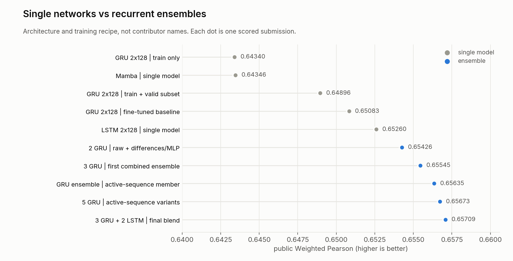

Selected observed submissions illustrate the trajectory:

| Approach | Public WP | What changed |
|---|---:|---|
| Independently trained GRU (2 × 128) | 0.63988 | First trainable recurrent solution |
| GRU, training set expanded to 6,573 sequences | 0.64896 | 5,000 train + 1,573 labelled valid sequences |
| Fine-tuned baseline-shaped GRU | 0.65083 | A different initialisation/training path |
| Single LSTM (2 × 128) | **0.65260** | Strongest recorded standalone network |
| Two-GRU ensemble | 0.65426 | Standard GRU + first-difference/MLP GRU |
| Three-GRU ensemble | 0.65545 | Added a distinct recurrent predictor |
| GRU blend including activity-selected model | 0.65635 | More varied training distributions |
| Five-GRU blend | 0.65673 | Larger all-GRU ensemble |
| **Final 3 GRU + 2 LSTM** | **0.65709** | Mixed architectures + optimised CPU runtime |

This table is an **observational submission history**. The runs do not form a single-variable ablation: checkpoints, training data and ensemble composition sometimes changed simultaneously. We do not assign an exact causal score gain to any one modification based on this table alone.

## 6. Final ensemble: five specific models

The final archived solution (`final5_mx16_submission.zip`) was examined using its packed `weights.npz` metadata and `solution.py`. It contains **five** recurrent networks, not seven. The first two network parameter sets also match those in the earlier two-GRU submission.

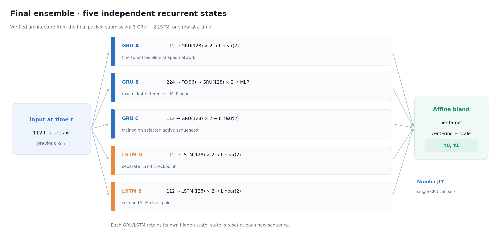

| Member | Exact architecture family | Main distinction |
|---|---|---|
| **GRU A** | 112 → GRU(128) × 2 → Linear(2) | Fine-tuned baseline-shaped GRU |
| **GRU B** | `[x_t, x_t−x_(t−1)]` (224) → normalise/clip → Linear(96) + SiLU → GRU(128) × 2 → concat recurrent output and 96D projection → MLP(224→64→2) | Explicit current/first-difference input and nonlinear prediction head |
| **GRU C** | 112 → GRU(128) × 2 → Linear(2) | High-activity-sequence training recipe |
| **LSTM D** | 112 → LSTM(128) × 2 → Linear(2) | First recurrent-cell variant |
| **LSTM E** | 112 → LSTM(128) × 2 → Linear(2) | Independent LSTM weights/checkpoint |

**What can and cannot be inferred from weights:** the architectures and five-member count are directly supported by the packed metadata. The exact training history of each LSTM checkpoint cannot be established unambiguously from weights alone; training notebooks provide further context but are not a substitute for the original training logs.

### Why mix GRU and LSTM?

Both process temporal dependencies, but their gating mechanisms differ. A GRU maintains a recurrent hidden state; an LSTM additionally maintains a separate cell state. Combining checkpoints of distinct recurrent cells and training recipes can reduce **correlated model errors**. The best observed public mixed ensemble is consistent with that rationale; the available logs do not provide an independent, controlled local comparison of GRU and LSTM errors. They do not prove that adding *any* LSTM or increasing ensemble size *always* helps.

### How the predictions were combined

The members share the same time step but maintain separate recurrent states. For each of the two targets, predictions were centred and scaled prior to a near-equal-weight blend. The exported implementation folds this into fixed coefficients:

$$
\hat y_j=c_j+\sum_{k=1}^{5}a_{kj}p_{kj}, \qquad j\in\{0,1\}.
$$

Here `p_kj` is the raw prediction of network `k` for target `j`; `a_kj` and `c_j` are packed in `coef` and `const`. This is not a fitted, high-dimensional stacking meta-model. Learned blend weights and complex per-family calibration generally did not beat simple standardised averaging reliably.

## 7. Inference under a 60-minute CPU limit

### Why ordinary batched GPU inference was not available

The platform calls the prediction callback one row at a time. Every sequence has **20,000** steps, and recurrent state must persist between steps but **not** between sequences. On test there are **39.4 million** such calls, with one CPU core and a 60-minute wall-clock limit.

The total average budget is

$$
\frac{60\cdot 60}{39{,}400{,}000} \approx \boxed{91.4\ \mu s\text{ per row}}
$$

including callback and execution overhead. The best recorded run completed in **43 min 32 s**, corresponding to roughly **66.3 μs per row end to end**.

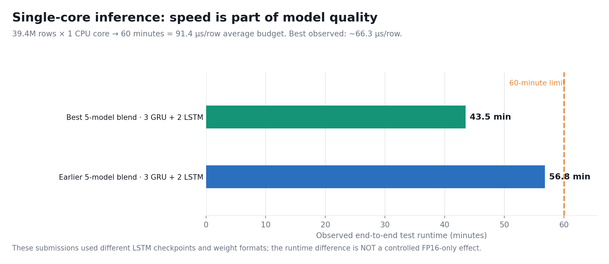

### What the custom Numba engine actually does

Training remained in **PyTorch**. For deployment, model parameters were exported and packed into an array-oriented format:

| Packed item | Purpose |
|---|---|
| `mats` | Transposed recurrent/linear weight matrices, stored compactly (FP16 for the final submission) |
| `flat` | Biases and additional scalar/array parameters |
| `meta` | Matrix shape, offset and type descriptions |
| `mods` | Network descriptions and recurrent state layout |
| `coef`, `const` | Per-target affine ensemble coefficients |

The engine evaluates the GRU/LSTM gate equations directly using Numba JIT-compiled numerical kernels. That avoids launching many separate PyTorch/ONNX calls for every single row. Matrices are packed for memory locality; recurrent states are updated in place; weight storage is compact while the main arithmetic remains in `float32`.

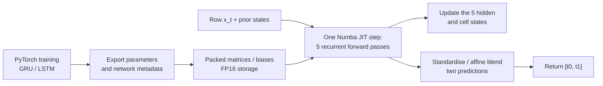

**Numerical safeguards.** The packed implementation includes a deterministic reference-input self-test and resets state when the sequence changes. Export checks compare model outputs on representative sequences. These checks establish internal numerical consistency within tolerance, not the absence of generalisation error.

### Runtime versus score

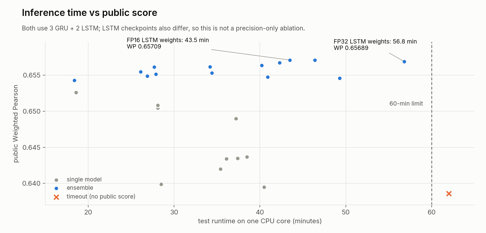

Two recorded five-model submissions took **56 min 46 s** and **43 min 32 s**, respectively, while their public scores were **0.65689** and **0.65709**. The latter used FP16-stored LSTM weights. **However, the compared submissions also differed in LSTM checkpoints**, so this comparison does not isolate the causal speed or score effect of changing only weight precision. A controlled benchmark on identical weights would be required for that claim.

The operational lesson remains: a model that is accurate but exceeds the 60-minute limit is not a valid submission. Runtime must be measured on the actual deployment path, not inferred from Colab/GPU speed.

## 8. What did not work

Good experiments include failed hypotheses. Negative results constrained later decisions and helped avoid a more complicated final solution.

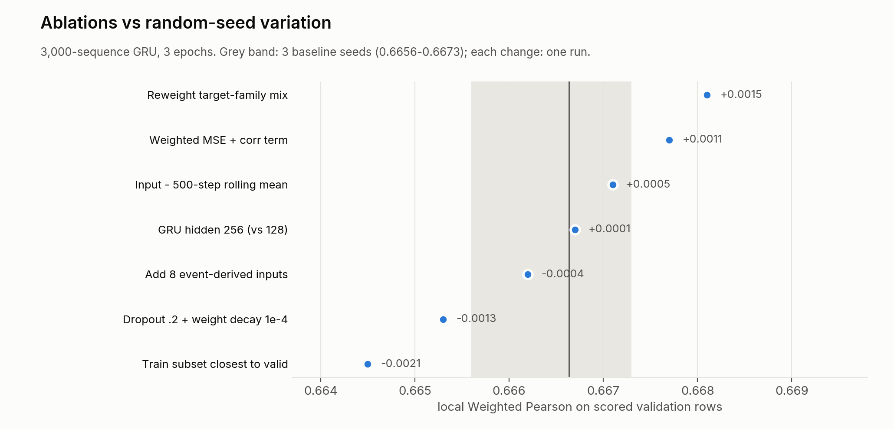

**Local 3,000-sequence ablations** (separate from leaderboard submissions) were often comparable to baseline seed variation. For example, a larger GRU (hidden size 256) scored **0.6667**, while the three reference seeds ranged **0.6656–0.6673**, with significantly more computational cost. This is not enough to justify calling it a robust improvement.

| Hypothesis tested | Outcome / interpretation |
|---|---|
| **Wider/deeper or different sequence model** — GRU(192/256), Mamba, multiple branches, longer BPTT | Local gains were inconsistent, absent publicly or not worth inference cost. |
| **Add engineered event/flow information** — explicit differences, rolling/EMA deviations, event counters/tape, spread/OFI proxies | No stable gain over raw features. In particular, replacing volume levels with deviations was harmful for F3. |
| **Predict 63 discrete target values as classes** | Classification head substantially reduced the local result (reported about −0.035 WP). |
| **Optimise closer to Pearson** — add a correlation term, modify `|y|^β`, weight only scored rows | Some small experiments looked better; improvements did not consistently survive larger training runs. |
| **Regularisation/weight averaging** — dropout, EMA, SWA, longer training | Mostly within noise; some runs overfit after around eight epochs. |
| **Learn ensemble stacking/calibration** — fitted weights, nonlinear transforms, per-family scaling | Generally worse or more fragile than simple standardised averaging. |
| **Distil multiple recurrent models into one** | The student failed to beat the teacher ensemble in the tested setup. |
| **Recover previous targets from price events** | Reconstructed information already visible in input history; no reliable added value. An initially impressive “oracle” gain was traced to leakage from future-overlapping windows. |

One important nuance: **difference inputs alone did not establish a stable single-model gain**, yet the final blend still included a GRU with such inputs. This is not contradictory: architectural diversity can be useful in an ensemble even if a feature transform is not independently superior.

## 9. Limitations, lessons and reproducibility

### What the evidence supports

- The final packed file contains **3 GRU + 2 LSTM**, combining raw and difference-feature architectures.
- The best recorded public submission has **0.65709 WP** and passes the recorded test-time limit.
- There was measurable **train/valid distribution shift**; high-activity sequence selection was part of the higher-scoring submitted blends, but its isolated contribution was not established by the recoverable local logs.
- Ensembling improved observed public results, while many architecture and feature-engineering ideas did not generalise consistently.

### What it does *not* support

- **No verified private score or final private ranking** is included in the archive.
- **No exact causal improvement** can be assigned to an individual model solely from sequential public submissions.
- The exact market meaning of `t0`/`t1` is **undisclosed**; event-time interpretations remain hypotheses.
- The exact final model checkpoint lineage and final CPU runtime cannot be reproduced from the public code alone without the original saved training weights and packed deployment files.

### Lessons to carry forward

1. **Read the metric literally.** Clipping and per-target weights matter just as much as the architecture.
2. **Validate across distributions and seeds.** Small local gains are not necessarily robust.
3. **Analyse failures by subgroup.** The hardest target family guided useful diagnostics, even where targeted fixes failed.
4. **Prefer diversity over arbitrary complexity.** The final mixed GRU/LSTM ensemble performed better than the simpler submitted alternatives.
5. **Treat deployment constraints as part of ML design.** Single-row CPU inference dictated the final engineering architecture.

### Reproduction map

| Research component | Location |
|---|---|
| Competition WP metric and family logic | [`src/wnn/metric.py`](src/wnn/metric.py) |
| Price-event activity and causal features | [`src/wnn/features.py`](src/wnn/features.py) |
| Active sequence selection and family reweighting | [`src/wnn/data.py`](src/wnn/data.py) |
| GRU/LSTM definitions and TBPTT training | [`src/wnn/models.py`](src/wnn/models.py), [`src/wnn/train.py`](src/wnn/train.py) |
| Experiment notebooks and outputs | [`notebooks/`](notebooks/) |
| Raw figure data | [`docs/results/`](docs/results/) |
| Regenerate README charts | `python docs/figures.py` |
| Regenerate report-only charts | `python docs/report_figures.py` |
| Tests | `pytest -q` |

```bash
pip install -e ".[train,dev,figures]"
pytest -q
python docs/figures.py
python docs/report_figures.py
```

**Data and deployment availability:** Competition Parquet files are intentionally not bundled. The repository contains training and research code and the small output tables used in figures. The historical final submission archive, trained checkpoints and packed inference weights are separate artifacts; the commands above regenerate figures and tests, **not the exact 0.65709 leaderboard submission**.

---

*Sources: recorded notebook outputs, repository code, packed final submission inspected for architectural details, and timestamped submission results stored in [`docs/results/submissions.csv`](docs/results/submissions.csv). Selected numerical findings in this report are historical experiment observations and should be interpreted with their stated validation scope.*
